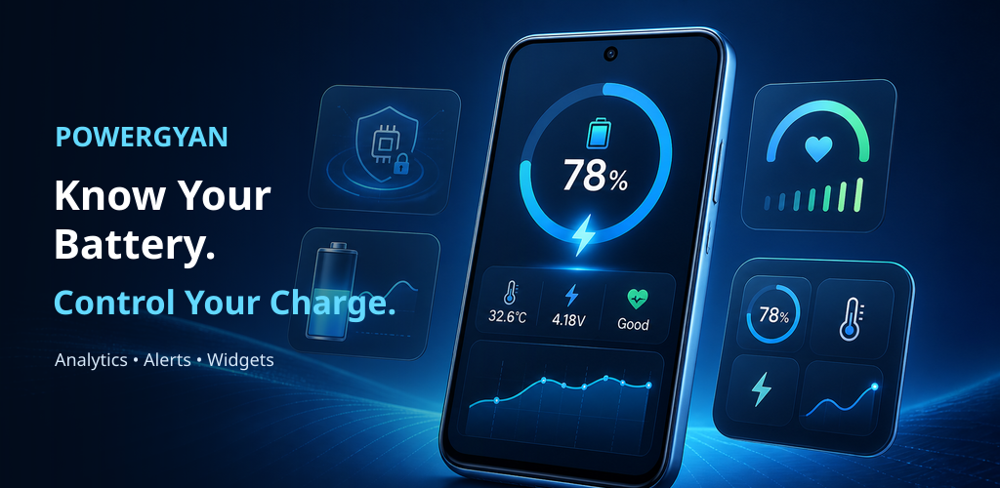
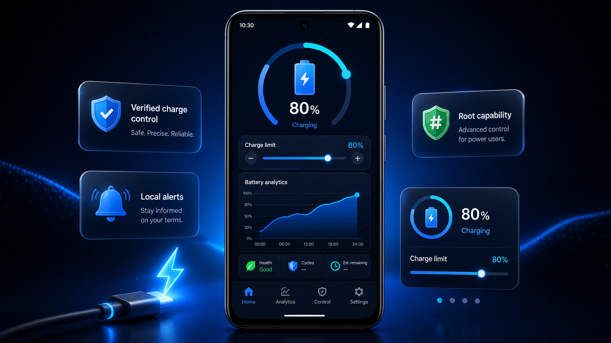
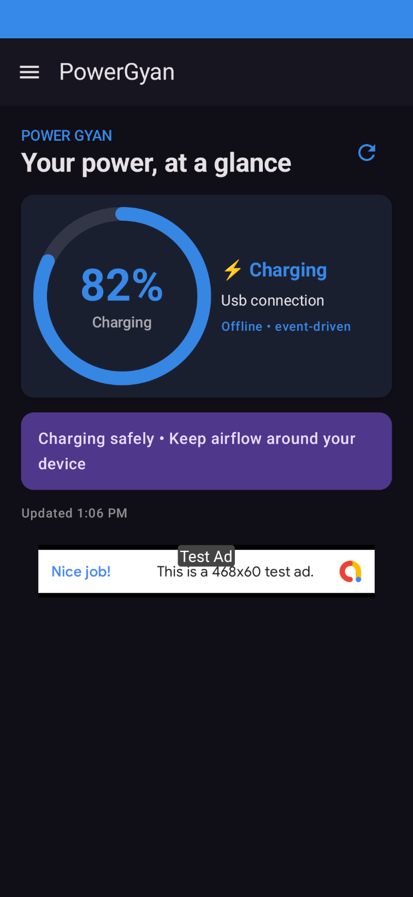
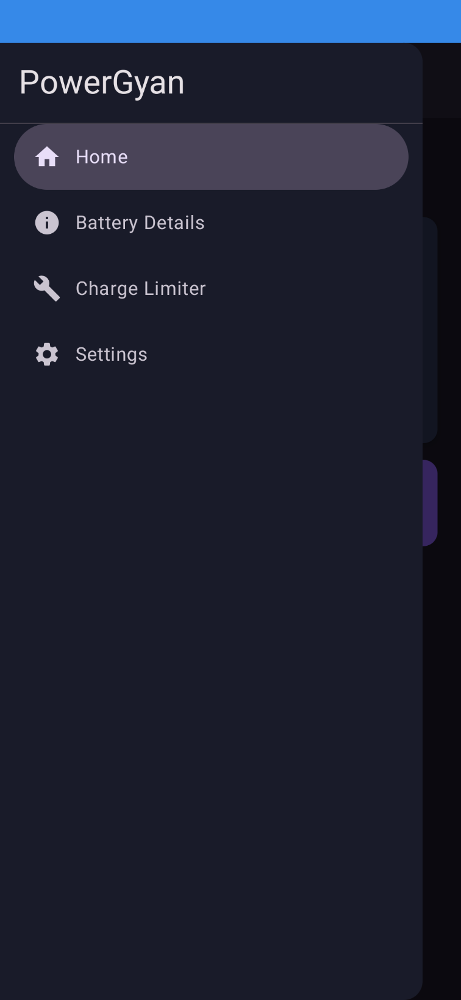
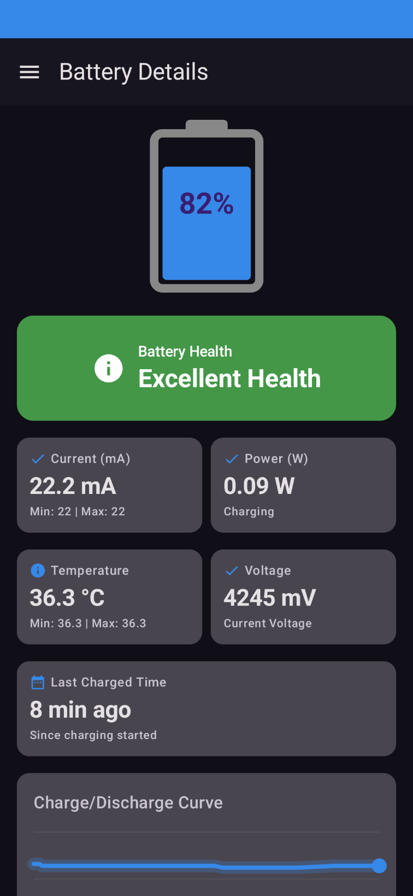
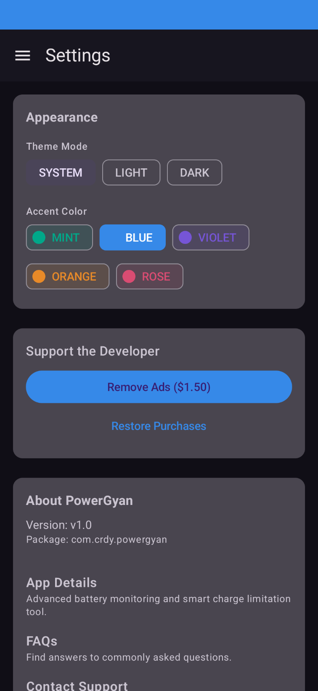
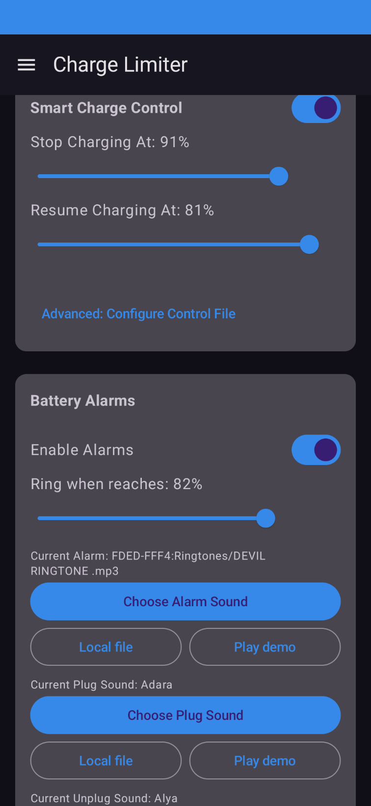

<div align="center">



<p><strong>PowerGyan - Charge Limiter &amp; Battery Analytics [Root]</strong></p>


<br /><br />


</div>

PowerGyan is an Android battery dashboard for users who want clear battery information, local alerts, widgets, and optional capability-based charge control. Standard battery information works without root or internet access.

## App preview

This is the interface included in the `v1.0.6` APK. The generated feature image summarizes the product direction; the screenshots are captured from the running app.

Play Console icon: [powergyan-app-icon.png](docs/images/powergyan-app-icon.png), a 512×512 PNG exported from the adaptive launcher icon.

Play Console feature graphic: [powergyan-feature-graphic.png](docs/images/powergyan-feature-graphic.png) — 1024×500 RGB PNG.

<div align="center">

</div>

<table>
<tr>
<td align="center"><br /><sub>Home dashboard</sub></td>
<td align="center"><br /><sub>Navigation drawer</sub></td>
<td align="center"><br /><sub>Battery details</sub></td>
</tr>
<tr>
<td align="center"><br /><sub>Appearance settings</sub></td>
<td align="center"><br /><sub>Charge limiter and alarms</sub></td>
<td align="center">⚡<br /><sub>Root and non-root capability paths</sub></td>
</tr>
</table>

## Features

**Works on any phone**
- Live battery percentage, status, power (W), temperature, voltage, current and charge cycles where the phone reports them.
- 24-hour battery graph, charging-speed chart (power at each battery level) and time-to-full estimate.
- Battery wear: estimated capacity compared with the design capacity.
- Screen-on vs screen-off drain rate since you last unplugged.
- Charge alarm at a chosen level and at 100%, low-battery warning, and plug/unplug sounds (system sounds or your own files).
- Home-screen widget with level, status and a 24-hour line.
- Export battery history as CSV; back up and restore settings to a file.
- Light, dark and system themes with five accent colors.

**With root (Magisk, KernelSU or APatch)**
- Smart Charge: stop charging at a level and start again when it drops.
- Lower stop level on wireless chargers.
- Full by a set time: hold at your limit overnight, then top up to 100% before you wake.
- Pause charging when the battery is hot, with 2°C hysteresis.
- Built-in control files for common Qualcomm, Samsung, Pixel and MediaTek kernels, a manual override, and a **Test charge control** button that checks it works on your phone.
- Quick Settings tile to turn Smart Charge on and off.

## How to use

### Smart Charge (root)
1. Grant PowerGyan root access in your root manager.
2. Open **Control**, turn on **Smart Charge** and set the stop and start-again levels.
3. While charging, tap **Test charge control** to confirm your phone's control file works.
4. Plugging in between the two levels always charges up to the stop level.

### Alarms (no root)
1. Open **Control** and turn on **Battery alarms**.
2. Pick the level to ring at, an optional low-battery warning, and sounds.
3. The charge alarm shows full screen, even on the lock screen, until you tap **Stop alarm**.

## Charge control safety

Charge control depends on your phone's kernel and isn't universal. Values are validated before they reach `su`. PowerGyan turns charging back on when you unplug, turn off Smart Charge, or the monitor stops. If charging ever stays off (for example after a force stop), restarting the phone restores it.

## Under the hood: The Xiaomi / HyperOS charge loop & hardware resilience

### The problem in plain English (for everyone)
Imagine setting your charging limit to stop at **90%** and only resume when the battery drops to **87%** (a 3% rest gap to protect battery health).

On certain devices—most notably **Xiaomi phones running MIUI or HyperOS**—users encountered an unexpected cycling loop:
1. The phone charged up to **90%** and stopped.
2. A split-second later, the battery reading naturally settled to **89%**.
3. Instead of waiting patiently until 87%, the phone **instantly started charging again** right at 89%!
4. It charged back to 90%, disconnected, dropped to 89%, reconnected, and repeated this cycle endlessly.

#### Why did this happen?
When PowerGyan tells a phone to stop charging, it switches off the phone's internal power gate (`input_suspend = 1`). 

On Xiaomi and several Qualcomm/MediaTek devices, cutting power at the chip level makes the Android system think: *"Wait, power just vanished! The user must have physically yanked the charging cable out of the wall!"*

Android immediately broadcasted an "UNPLUGGED" intent. PowerGyan's safety fallback heard this and thought: *"Oh, the user unplugged the phone. Let me reset the charging switch back to normal so they can charge next time."* 

Because the cable was **actually still plugged into the wall**, restoring the switch caused charging current to rush right back in! The phone woke up, saw 89%, assumed a brand-new plug-in session had just started, and charged right away.

---

### The technical root cause (for engineers & coders)

```
[ Battery hits 90% ]
         │
         ▼
[ Write input_suspend = 1 ] ────────► PMIC cuts VBUS line
                                              │
                                              ▼
[ Android BatteryService fires EXTRA_PLUGGED = 0 ]
         │
         ▼
[ Service sees plugged == NONE ] ───► Triggers restoreCharging() (Safety Fallback)
                                              │
                                              ▼
                                      [ input_suspend = 0 ]
                                      [ lastDecision = null ]
                                      [ justPlugged = true ]
                                              │
                                              ▼
[ Load voltage settles to 89% ] ────► decideCharging(89%, justPlugged=true)
                                              │
                                              ▼
                                    Returns ChargeDecision(charge=true)
                                              │
                                              ▼
                              [ Loop Repeats Endlessly ]
```

1. **Kernel Sysfs Interaction**: On Xiaomi / HyperOS / MediaTek / Qualcomm devices, the standard charging switch is `/sys/class/power_supply/battery/input_suspend` (or `/proc/mtk_battery_cmd/en_power_path`). Setting it to `1` suspends input at the hardware PMIC level.
2. **Framework Misinterpretation**: The Android kernel battery driver reports `charger offline` / `VBUS 0V`. Android framework's `BatteryService` broadcasts `Intent.ACTION_BATTERY_CHANGED` with `BatteryManager.EXTRA_PLUGGED = 0` (`PluggedState.NONE`).
3. **The Hysteresis Invalidation Flaw**:
   In older versions, the background service evaluated:
   ```kotlin
   val pluggedIn = snapshot.plugged != PluggedState.NONE
   if (!pluggedIn || !config.enabled) {
       restoreCharging() // reset input_suspend = 0 and lastDecision = null
       justPlugged = true
   }
   ```
   The fake disconnect immediately wiped the memory of previous decisions (`lastDecision = null`) and marked `justPlugged = true`.
4. **The Voltage Rebound & Fast-Charge Branch**:
   When charging current is cut under load, terminal battery voltage naturally dips ~1% (e.g. 90% -> 89%). When the OS re-detected the charger after `restoreCharging()`, `decideCharging` saw `justPlugged == true`, overriding the hysteresis threshold and forcing an immediate restart at 89%.

---

### Reverse-engineering industry benchmarks (`Battery Charge Limit`)

To design an airtight solution, we reverse-engineered the industry standard root charging tool **Battery Charge Limit (`com.slash.batterychargelimit`)** by decompiling its production APK (`jadx`):

1. **State Machine Holding (`chargedToLimit`)**:
   In BCL's `BatteryReceiver.java`, once the limit is hit, `chargedToLimit` is latched to `true`. While `chargedToLimit` is active, BCL **never** re-enables charging as long as `level >= rechargePercentage`. Battery dips to 89% or 88% are completely ignored.
2. **Debounce Suppression Window (`isChangePending`)**:
   In `PowerConnectionReceiver.java` and `SharedMethods.java`:
   ```java
   if (SharedMethods.isChangePending(3000L)) {
       if (action.equals("ACTION_POWER_DISCONNECTED")) {
           Log.d("Power State", "ACTION_POWER_DISCONNECTED ignored");
           return;
       }
   }
   ```
   Any disconnect event occurring within 3000 ms of a charging state transition is identified as a PMIC hardware echo and discarded.
3. **Unplug Verification Timing**:
   BCL only verifies unplug (`stopIfUnplugged()`) when charging is **ON** (`CHARGE_FULL` or `CHARGE_REFRESH`), because when input is suspended, PMIC presence is masked by the OS.

---

### The PowerGyan Solution

We implemented an elegant, minimal-diff state machine in `BatteryMonitorService.kt`:

```kotlin
// 1. Identify holding state between the stop limit and the lower resume limit
val limits = config.limitsFor(if (snapshot.plugged != PluggedState.NONE) snapshot.plugged else lastPluggedState, minuteOfDay)
val isHolding = lastDecision?.charge == false && snapshot.percentage > limits.second

// 2. Suppress PMIC switch transient echoes for 3.5 seconds
val isDebouncing = System.currentTimeMillis() - lastSwitchTimestamp < 3500L

// 3. Keep connection session alive if holding or debouncing
val pluggedIn = snapshot.plugged != PluggedState.NONE || isHolding || isDebouncing
```

#### How it works in practice:
- **During the Hold (90% down to 87%)**: Even though Android broadcasts `plugged = 0`, `isHolding` keeps the session locked. `restoreCharging()` is forbidden from running. The persistent status bar notification clearly displays:  
  `"Holding at 90%. Charging starts again at 87%."`
- **At the Resume Threshold (87%)**: `isHolding` unlocks, and `enforceSmartCharge` safely re-enables charging (`input_suspend = 0`).
  - **If the cable is still plugged in**: Android detects active power (`plugged != NONE`), and the phone smoothly charges back up to 90%.
  - **If the user physically unplugged during the hold**: With charging enabled, Android confirms no current is flowing (`plugged == NONE`). After the 3.5s grace period, the session cleanly resets for the next time the phone is plugged in.
- **Across Reboots & Service Restarts**: If the service restarts while holding at 89%, it inspects `/sys/class/power_supply/battery/input_suspend`. Seeing it already suspended, it seamlessly recovers the holding state without glitching.

## Privacy and permissions

PowerGyan has no internet permission, no ads, no analytics and no accounts. Battery history and settings stay on the phone. It uses notification, boot, foreground-service and full-screen-alarm permissions for monitoring and alarms, and optional root only to switch charging. It doesn't request location, contacts, camera, microphone or accessibility access.

## Build and test

Requires Android Studio, JDK 17, and Android SDK 36 (Android 16).

```bash
git clone https://github.com/ritikthakur22/battery-info_app.git
cd battery-info_app
./gradlew assembleDebug
./gradlew test
./gradlew lint
```

Application ID: `com.crdy.powergyan`  
Version: `1.0.6` (Version Code: 6)  
Minimum Android version: API 29

Release signing is local/secret-only. Use an ignored `keystore.properties` file for a signed build. Never commit keystores, passwords, local properties, or production credentials.

## Project structure (Source-Available)

This repository operates on a **Source-Available** model. To protect the intellectual property and core algorithms of PowerGyan, this repository is not fully open-sourced, nor is it fully closed-source. 

Certain structural files, UI components, and build scripts are visible for transparency and personal inspection. However, proprietary source codes, backend logic, and critical algorithmic files within the `app/src/` directory are deliberately un-tracked and omitted from this public repository.

## Release

The `v1.0.6` release contains the signed release APK and Play Console AAB:

[Download PowerGyan v1.0.6](https://github.com/ritikthakur22/battery-info_app/releases/tag/v1.0.6)

## License

**Source-Available Proprietary License — Personal Inspection Only / No Unauthorized Reuse or Commercial Use**

This software is strictly proprietary. By accessing this repository, you are granted permission to download and inspect the available source files for personal, educational, or auditing purposes. You may **NOT** modify, reuse, distribute, decompile, or commercially exploit any part of this software, its source code, or its compiled binaries. Please read the `LICENSE` file for the full legal terms.

## Support

- Email: [ritikthakur22in@gmail.com](mailto:ritikthakur22in@gmail.com)
- GitHub: [github.com/ritikthakur22](https://github.com/ritikthakur22)

<div align="center">

</div>
